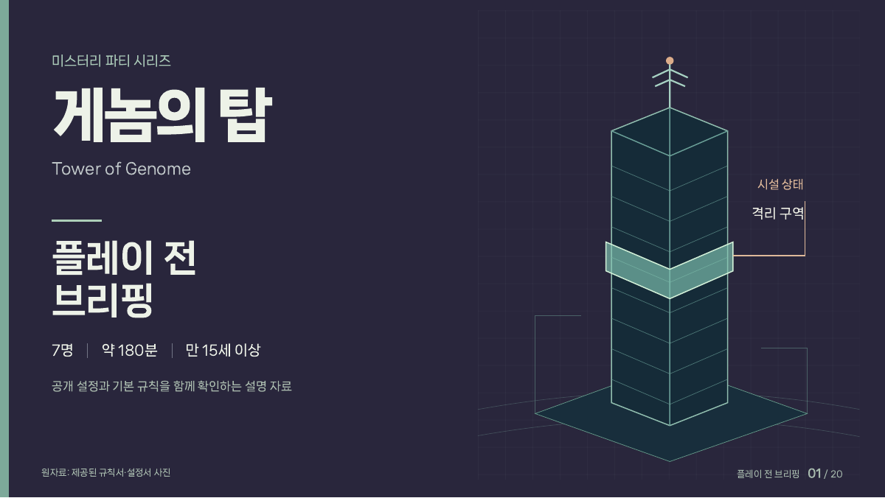

# 게놈의 탑 · 플레이 전 브리핑

[애니메이션 발표본](https://mingeun0507.github.io/genome-briefing/) · [설명 PDF](./게놈의_탑_플레이_브리핑.pdf)

7인 머더 미스터리 《게놈의 탑》의 공개 설정·기본 규칙을 정리한 20장 설명 자료.
밀담 조 편성, 조사, 의학적 지식 합산, 녹음기 소집, 정보 공유 시연 포함.

## 조작

- `→` 또는 `Space`: 다음 단계·다음 장
- `←`: 이전 단계·이전 장
- `M`: 목차
- `F`: 전체화면
- `처음 단계`: 현재 시연 처음으로

`index.html`을 브라우저로 직접 열어도 동작. PDF 다운로드 버튼을 쓰려면 PDF도 같은 폴더에 유지.

## 게시

GitHub Pages에서 `main` 브랜치의 루트를 배포. 빌드·외부 스크립트·서버 불필요.
HTML에 글꼴과 스크립트가 포함되어 있으며, PDF에는 시연의 정지 그림 수록.

## 자료·저작권

- 제공된 규칙서·캐릭터 공개 설정 촬영본 19장 기반의 비공식 플레이 보조 자료.
- 원작: Group SNE & cosaic. 한국어판: 엠티에스게임즈.
- 클라이맥스 북 내부·개별 비밀 설정·실제 조사 카드 내용 미수록.
- 원작 규칙서와 카드의 구체적인 지시 우선.
- 내장 나눔스퀘어 네오 글꼴: NAVER Corporation, SIL Open Font License 1.1.
- 글꼴 공식 안내: https://hangeul.naver.com/font / https://help.naver.com/service/30016/contents/18088
